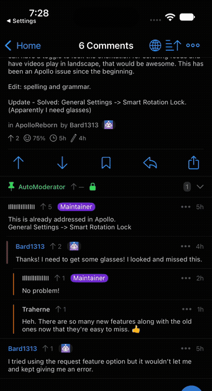

# Session restoration simulator evidence

This capture is from the real Apollo 1.15.11 app shell running the freshly built
Apollo Reborn tweak on an iPhone 16 Pro simulator with iOS 27 in non-Glass mode.
The account tab was cropped from the published GIF to avoid exposing account
identity; no application behavior was removed from the sequence.

## Exercised path

1. Apollo displayed a scrolled comments screen for post `t3_1x9alu4` and the
   background lifecycle persisted visible comment identity `t1_phjnt7p`.
2. The saved feed item was deliberately replaced with nonexistent
   `t3_missing`, reproducing the case where a refreshed feed no longer contains
   the post that was open.
3. Apollo was explicitly terminated to model iOS process eviction, then
   cold-launched.
4. The restored process logged `Cold launch has a recent reading session` at
   `19:28:57.621` and `Restored post anchor t1_phjnt7p` at `19:28:59.475`.
5. The same comments viewport is visible before termination and after the cold
   launch. The account tab is cropped from the GIF; no application behavior is
   removed from the sequence.

## Evidence boundary

This demonstrates simulator cold restoration of an open post and its
identity-based visible-comment anchor even when the saved feed anchor is no
longer available. Separately, Dan performed the requested physical-device
acceptance flow on build 352—open a post, stop at a recognizable comment,
force-close Apollo, and reopen—and reported that Apollo returned to the same
post/comment position. That device result is user-reported, not direct
observation by the contributor. Overnight suspension and a real
memory-pressure eviction remain untested on build 352.

## Review follow-up

The GIF and physical-device report above cover build 352. They predate the
review follow-up and are not presented as evidence for its additional edge
cases. The published follow-up through `c3c18aa0` keeps the original behavior
and addresses seven review findings by:

- retaining bounded feed page depth and asking Apollo's own batch-fetch adapter
  for those pages before falling back to a pixel offset;
- retaining the active feed and comment sorts (except Live Update, whose timer
  Apollo only starts through its interactive menu);
- saving a contextual comment permalink for the visible comment;
- continuing feed-anchor restoration while its restored post is on top;
- completing feed and detail restoration independently so either phase cannot
  cancel the other;
- retrying restoration from Apollo's account-ready notifications when account
  identity was not available during the first lifecycle callbacks, while
  preferring the coherent live identity from those notifications over a stale
  persisted account mirror; and
- restricting restored comment sort and viewport state to the saved post and
  optional contextual-comment identity.

An eighth P2 follow-up in `295603b0` makes URL-routed comments controllers
match the saved route from their pre-fetch `linkID` and `commentID` Swift ivars
instead of waiting for an `RDKLink` that is not populated until the first
fetch. Two further review fixes ensure that an explicit URL, notification,
activity, or quick-action cold launch takes precedence over passive session
restoration, and that backgrounding during an incomplete restore keeps the
last complete disk snapshot instead of erasing its pending detail state. A
further navigation-lifecycle fix finishes a restore phase when its controller
is popped or superseded, while allowing a temporarily hidden top controller to
restart on its next appearance. Pre-fetch feed-sort writes are also restricted
to the controller whose route matches the saved feed, leaving unrelated startup
and secondary-pane listings unchanged.

The lifecycle transition audit additionally waits for a sort-triggered reload
to replace its old rows before reading viewport identity, revalidates the feed
route on every anchor/page retry, and retains the sole disk snapshot after a
missing/rejected post until the feed phase also reaches a terminal state. It
also suppresses an unstarted detail route when the user replaces the restored
feed in place, while preserving an already-started detail phase independently.
An account-ready notification also cancels an active restore when Apollo's live
identity no longer matches the snapshot, invalidating all queued callbacks.

The Foundation host harness now exercises 75 state, route, bounds, launch-
precedence, persistence, and restore-eligibility checks under
`-Wall -Wextra -Werror`. The prior seven-finding state completed a full arm64
package build with SDK 27.1 and an iOS 15.0 deployment target; no app/package
build has been launched for the eighth through tenth fixes because Dan's gate
requires clean, resolved reviews first. The new deep-page, non-default-sort,
late-account, pre-fetch identity, explicit-launch, and interrupted-restore paths
have not yet been recaptured in the simulator or accepted on a physical device.
