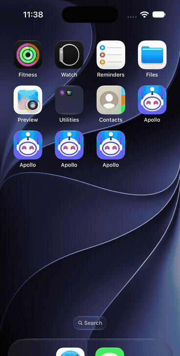

# Session restoration simulator evidence

This capture is from the real Apollo 1.15.11 app shell running the freshly built
Apollo Reborn tweak on an iPhone 16 Pro simulator with iOS 27 in non-Glass mode.
The account tab was cropped from the published GIF to avoid exposing account
identity; no application behavior was removed from the sequence.

The second capture is a separate regression test made from the exact bounded
session plist copied from build 354 on the physical test device. It cold-launches
the corrected simulator build into the full 40-comment Fios post, near the saved
AutoModerator comment anchor, without the blue **View All Comments** single-thread
banner. Its bottom tab bar is cropped only to hide account identity.

## Exercised path

1. Apollo displayed a scrolled comments screen for post `t3_1x9alu4` and the
   background lifecycle persisted visible comment identity `t1_phjnt7p`.
2. The saved feed item was deliberately replaced with nonexistent
   `t3_missing`, reproducing the case where a refreshed feed no longer contains
   the post that was open.
3. Apollo was explicitly terminated to model iOS process eviction, then
   cold-launched.
4. The restored process logged `Cold launch has a recent reading session` at
   `19:28:57.621` and `Restored post anchor t1_phjnt7p` at `19:28:59.475`.
5. The same comments viewport is visible before termination and after the cold
   launch. The account tab is cropped from the GIF; no application behavior is
   removed from the sequence.

## Evidence boundary

This demonstrates simulator cold restoration of an open post and its
identity-based visible-comment anchor even when the saved feed anchor is no
longer available. Dan later reported that build 354 reopened full-thread reading
as a single-comment context. A targeted read-only copy of that build's bounded
session plist confirmed that the correct post, comment anchor, sort, and account
scope had been saved, but the visible anchor had also been promoted into the URL
route. The second capture verifies the corrected route/anchor separation against
that exact snapshot. It demonstrates a near-anchor result because live Reddit
content and row heights changed between device capture and simulator replay; it
does not claim exact pixel equality. The corrected build has not yet been
accepted on a physical device, and overnight suspension or real memory-pressure
eviction remains untested.

## Review follow-up

The GIF and physical-device report above cover build 352. They predate the
review follow-up and are not presented as evidence for its additional edge
cases. The published follow-up through `c3c18aa0` keeps the original behavior
and addresses seven review findings by:

- retaining bounded feed page depth and asking Apollo's own batch-fetch adapter
  for those pages before falling back to a pixel offset;
- retaining the active feed and comment sorts (except Live Update, whose timer
  Apollo only starts through its interactive menu);
- preserving full-post versus genuine single-comment navigation context
  separately from the visible comment viewport anchor;
- continuing feed-anchor restoration while its restored post is on top;
- completing feed and detail restoration independently so either phase cannot
  cancel the other;
- retrying restoration from Apollo's account-ready notifications when account
  identity was not available during the first lifecycle callbacks, while
  preferring the coherent live identity from those notifications over a stale
  persisted account mirror; and
- restricting restored comment sort and viewport state to the saved post and
  optional contextual-comment identity.

An eighth P2 follow-up in `295603b0` makes URL-routed comments controllers
match the saved route from their pre-fetch `linkID` and `commentID` Swift ivars
instead of waiting for an `RDKLink` that is not populated until the first
fetch. Two further review fixes ensure that an explicit URL, notification,
activity, or quick-action cold launch takes precedence over passive session
restoration, and that backgrounding during an incomplete restore keeps the
last complete disk snapshot instead of erasing its pending detail state. A
further navigation-lifecycle fix finishes a restore phase when its controller
is popped or superseded, while allowing a temporarily hidden top controller to
restart on its next appearance. Pre-fetch feed-sort writes are also restricted
to the controller whose route matches the saved feed, leaving unrelated startup
and secondary-pane listings unchanged.

The lifecycle transition audit additionally waits for a sort-triggered reload
to replace its old rows before reading viewport identity, revalidates the feed
route on every anchor/page retry, and retains the sole disk snapshot after a
missing/rejected post until the feed phase also reaches a terminal state. It
also suppresses an unstarted detail route when the user replaces the restored
feed in place, while preserving an already-started detail phase independently.
An account-ready notification also cancels an active restore when Apollo's live
identity no longer matches the snapshot, invalidating all queued callbacks.
Offscreen feed retries now remain eligible only while the specific restored
detail is on top (or the app itself is inactive); a tab switch or unrelated
push cancels paging and suppresses an unstarted saved-post route.
Background persistence revalidates selected-tab/navigation topology before it
defers, and duplicate foreground/feed timers become no-ops after detail routing
has begun.
Feed and post routing is scoped to the `UIWindowScene` whose foreground callback
began restoration; controllers in another iPad or visionOS window cannot
consume the global pending snapshot.

The Foundation host harness now exercises 99 state, route, bounds, launch-
precedence, persistence, and restore-eligibility checks under
`-Wall -Wextra -Werror`. The full-thread migration and genuine contextual-route
preservation are covered independently. The corrected tweak also completed a
full arm64 simulator build with SDK 27.1 and an iOS 15.0 deployment target and
the exact build-354 snapshot replay shown above, plus a full arm64 device-package
build with the same SDK and deployment target. The new deep-page,
non-default-sort, late-account, pre-fetch identity, explicit-launch, and
interrupted-restore paths have not all been recaptured independently or accepted
on a physical device.
